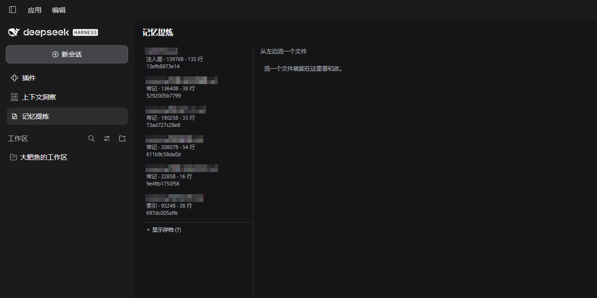
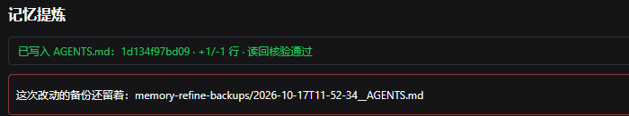

# dsh-memory-refine

**简体中文 | [English](README.en.md)**

DSH（DeepSeek Harness）的「记忆提炼」插件：把一场长对话提炼成候选条目，你逐条点头，再写进长期记忆文件 —— 面板里能直接看、直接改、直接删。

> 这不是商业产品，是我自己用出来的东西 —— 你要想要，拿去。（MIT）
> 它所有的判断都建立在一个前提上：长期记忆是你亲手确认过的东西，不是模型自己攒的。



---

## 它解决什么

- 会话日志越滚越长（一场下来几百条事件），真正的长期记忆却只有几份 `.md`；
- 手工翻记录提炼，容易漏，更容易把**引擎注入的提示词**当成「他说的话」；
- 直接改记忆文件没有安全网：写坏了没法退，两个人（人 + 模型）同时改会互相覆盖。

---

## 安装

前提：DSH 有 profile 机制（Desktop 版或带 profile 的 CLI）。

1. 把本目录放到任意位置（示例：`D:/plugins/dsh-memory-refine`）。**下面 `link:` 后面的路径要换成你自己放的位置。**

2. 在 profile 的 `package.json` 里加一条软链依赖：

   ```json
   {
     "dependencies": {
       "dsh-memory-refine": "link:D:/plugins/dsh-memory-refine"
     }
   }
   ```

3. 同一个文件的 `dsh.profile.bundles` 数组里加上它：

   ```json
   { "dsh": { "profile": { "bundles": ["dsh-memory-refine"] } } }
   ```

4. **重启整个 DSH 进程**。

> ⚠️ **改代码之后必须重启整个 DSH**。ESM 模块缓存按 URL 命中，在插件管理器里开关插件**不会**重新 import 新代码 —— 你会以为改了没生效。

装好后侧边栏会出现「记忆提炼」图标。

---

## 第一次用（面板是空的？）

新装的 DSH 通常**没有** `memory/` 目录，所以第一次打开面板时左栏可能是空的 —— 不是坏了。

不用手动建目录，两条路都能起第一份记忆：

1. **让模型建**：跟它说「帮我在 `memory/` 下建一份 `示例主题.md`，先写一行占位」。`memory_write` 会自动创建 `memory/` 目录和文件。
2. **自己建**：在 `DSH_HOME/memory/` 下新建 `.md` 文件，再点面板「刷新」。

`DSH_HOME` 在 Windows 上一般是 `C:\Users\<你的用户名>\.dsh`。

> `AGENTS.md` 是 DSH 的每轮注入层，不是插件建的。没有它插件照常工作，只是左栏少一项。

---

## 写记忆的几条规矩

插件只负责「安全地写」，**写什么**还是得靠人把握。三条踩过的坑：

1. **一条记忆一个 `<!--@refine-->` 块**。一个块里塞两件事，将来想单独改或删其中一条就扯不开了。
2. **主语写清楚**。别只写「名字，某某」—— 是给助手起名，还是说你自己叫这个？模型会宁可问你，也不乱猜（它会说：猜错了会被当成事实一直带着）。
3. **写完让它复述一遍**。「你读到的这条是什么意思，归谁？」比猜它懂没懂稳得多。

---

## 五个工具

插件注册五个模型可调用的工具，全部只碰白名单内的文件。

| 工具 | 作用 |
| --- | --- |
| `memory_list` | 列出受管文件：注入层 `AGENTS.md`、索引、常记、存档，带版本哈希与行数 |
| `memory_read` | 读一份受管文件（分页），附带层级、版本、总行数 |
| `memory_gather` | 把一场会话取成提炼素材，markdown 落盘，返回预览与统计 |
| `memory_write` | 写入受管文件。**必须用户点头**才会落盘 |
| `memory_import` | 把外部内容导入某个记忆文件（新起章节 / 追加） |

### `memory_gather` 的参数

| 参数 | 默认 | 说明 |
| --- | --- | --- |
| `session_id` | 当前会话 | 要提炼哪一场 |
| `mode` | `incremental` | `incremental` 只取水印之后的新轮次；`full` 取全程 |
| `boundary_seq` | 自动派生 | 手动指定边界（调试用） |
| `max_reasoning` | `0` | 每段保留多少推理字符，0 = 整段砍掉只留一行占位 |
| `out_dir` | 会话工作区下 `memory-refine-scratch/` | 素材落点 |

素材默认落在**会话自己的工作区**，不会往 DSH 的配置目录里堆。

---

## 面板

左侧「记忆提炼」图标 → 主面板。

- **左栏**：受管文件列表。存档默认折叠（`显示存档 (N)`），点一次展开。
- **右栏**：选中文件的正文，可以直接改。改完按「保存」。
- **顶栏**：
  - `刷新`：作废缓存，重新读磁盘。
  - `清理素材…`：删掉本会话工作区下 `memory-refine-scratch/` 里的素材文件（`material-*.md` / `tools-*.md`）。会先问一次，只认这两个前缀，不递归子目录。
- **写入后**：上方会留一条 `这版没问题，删掉备份` —— 你按下它，这次改动留下的那份备份才会被删掉。不按就留着。
- **重新读取**：选中一个文件，按「重新读取」→ 从磁盘再读一次。**保存时如果报「在你看过之后被改动过」，就用它** —— 多半是模型或另一个窗口刚写过这个文件。有没保存的改动时会先问你一句。
- **删除文件**：选中一个文件，按「删除…」→ 确认。会先整份备份到 `memory-refine-backups/` 再删。
- **导入…**：填目标文件 + 章节标题，然后在下面那个大框里放内容。大框两种填法都认：
  - **贴正文** —— 直接把要导入的文字粘进去；
  - **填绝对路径** —— 只写一个文件的完整路径（如 `D:\旧笔记.md`），它会自己去读那个文件。省得把几万字粘进来。
    判定收得很紧：**单行、长度 ≤ 4096、且是绝对路径、且文件确实存在**，四条全中才当路径；否则一律当正文。所以正文里恰好写了路径不会被误读。相对路径**不认**（Host 里没有确定的基准目录，猜错了会读到别的文件）。

> 注入层 `AGENTS.md` 在面板里**不可删除**，只能改。

---

## 安全设计

写入永远走同一条路（`index.js` 里的 `confirmAndWrite`）：

1. **版本哈希预检** —— 你手上这份的版本和磁盘上的对不上，直接中止，一个字节都不写；
2. **整份备份** —— 先落一份到 `DSH_HOME/memory-refine-backups/`；
3. **写后读回核验** —— 写完立刻读回来逐字比对，不一致就报失败。

一次成功的写入长这样（版本、行数变化、核验结果、备份路径都在一条里）：



另外：

- **写入必须用户点头**。拿不到问答服务时直接拒绝，**不静默降级**成「自动同意」。
- **白名单**：只认 `DSH_HOME/AGENTS.md` 与 `DSH_HOME/memory/**/*.md`。`..` 越界、盘外路径一律拒绝。
- **斜杠命令载荷不记录**：命令注册时 `recordInput: false`，会话日志里不会重复存一份完整输入 JSON。命令通道现在只是兜底，正常不走它（见下一节）。

---

## 面板怎么跟后台通信

面板跑在浏览器里，Host 跑在另一个进程 —— 中间没有私有的插件 RPC 通道（DSH 的能力集合在构建时固定，第三方插件加不进去）。

所以插件在 Host 半边挂了一条自己的 HTTP 路由：

```
POST /memory-refine/ui          ← 面板的每一次操作都走这里
  请求 { action, sessionId, ... }
  响应 { ok: true, data } 或 { ok: false, error }
```

这条路由：

- 只接受**本机、且通过 `connection.requestRejection` 信任校验**的请求（不自己造 token）；
- 四道闸：只认 `POST`；只认 `content-type: application/json`；请求体 8 MB 上限；鉴权不过直接 401/403；
- 把 `sessionId` 翻译成 agent 后交给**同一套** `handleUiRequest` —— 白名单、版本预检、备份、读回核验，和工具那条路走的是同一份代码。

**为什么需要它**：斜杠命令（`ctx.remote.commands.execute`）是第三方插件唯一能调到 Host 的方式，但它**按设计会往会话日志里写一对 `command/run` / `command/done`**，在对话视图里显示成一条 `memory-refine · {...}` 记录。走 HTTP 路由不进命令总线，就没有这条记录。

**兜底**：要是路由没注册上（老版本 DSH 没有 `webServer`），或者请求被拦，面板会自动回退到斜杠命令，并在顶部挂一条红色警告 —— 不会悄悄留痕。

---

## 会话取料是怎么做的

直接读 DSH 的会话事件流（`sessionQuery.readSession`），不碰磁盘上的 `session.v4.jsonl.zstd` —— 不用自己解多帧 zstd。

丢弃的东西：

- `<system-reminder>` 整块（AGENTS.md 变更通知就是这么进来的，**最容易被当成「他说的」**）；
- 裸运行时快照（`Current runtime context.` 之后的全部）；
- `request/header` 里的提示词清单；
- 推理正文（只留一行 `<!-- 推理已省略：本段 N 处共 X 字 -->`）。

### 水印：零外部状态

每次取料会在素材首行写：

```
<!--memory-refine:watermark session=<id> seq=<n> time=<t> turns=<k>-->
```

下次取料时，`deriveWatermark()` 扫一遍会话日志里的 `tool/result`，找上一次 `memory_gather` 留下的那行，取出 `seq` 当边界。

**好处**：不需要任何外部状态文件，不会像 `handledIds` 那样无限膨胀，天然按会话隔离。边界落在**轮**上（`user.seq > boundarySeq`），所以不会切在某一轮中间。

---

## 目录结构

```
memory-refine/
├── index.js         Host 半边：skill + 5 个工具 + 界面命令桥
├── client.js        浏览器半边：侧边栏图标 + 主面板
├── gather.js        纯函数：会话事件流 → 提炼素材（无 cordis 依赖，可单独测）
├── memory.js        受管文件访问层：白名单 + 版本哈希 + 备份 + 读回核验
├── protocol.js      提炼协议全文（作为 skill 注入）
├── test/smoke.mjs   离线冒烟测试：假 ctx + 沙盒 DSH_HOME
├── cordis.patch.yml 告诉 DSH 装哪一行
└── package.json
```

`gather.js` 刻意做成纯函数：输入事件数组，输出文本，不碰磁盘。这样可以拿导出的会话日志在沙盒里反复重放，不用重启 DSH。

---

## 测试

```
node test/smoke.mjs
```

不需要启动 DSH，也不会碰你的记忆文件 —— 它用假 `ctx` 加载 Host 半边，把 `DSH_HOME` 指到系统临时目录下的沙盒，跑完即删。

20 条断言，重点不在「功能能跑」，而在**手动点不出来的那些分支**：

- 四道闸：只认 `POST`（405）、只认已知子路径（404）、只认 JSON（415）、鉴权拒绝原样透传（403）
- 白名单越界被拒（`../../etc/passwd`）
- 写入：读回核验通过、备份文件真的生成了
- **版本不符时中止**（`deadbeefdeadbeef` → 一个字节不写）
- 导入的章节间距、删除的备份命名与「确实没了」的核验

这些分支在真实环境里要一条条制造出来，每条都得重启一次 DSH；在断言里是三行。

---

## 卸载

1. 从 profile 的 `package.json` 里去掉 `dsh-memory-refine` 依赖；
2. 从 `dsh.profile.bundles` 数组里去掉 `"dsh-memory-refine"`；
3. **重启 DSH**；
4. 可选清理：
   - `DSH_HOME/memory-refine-backups/` —— 写入前的备份（留着也许有用）；
   - 会话工作区下的 `memory-refine-scratch/` —— 取出来的素材（可以直接删）。

卸载**不会**动 `AGENTS.md` 和 `memory/` 里的任何东西。

---

## 已知限制

- **命令通道是兜底，不是主路。** 面板默认走插件自己的本地 HTTP 路由（`POST /memory-refine/ui`），**不经过命令总线**，所以正常使用时对话视图里不会出现 `memory-refine · {...}` 记录。只有在路由不可用时才回退到 `/memory-refine` 斜杠命令，留下一对 `command/run` / `command/done` —— 这时面板顶部会挂一条红色警告，告诉你发生了降级。这组事件**不进模型历史、不烧 token、不污染取料素材**。
- 面板在「一个会话都没打开过」时无法确定会话 id，会提示先打开一个会话。
- 只在 **Windows** 上验证过。
