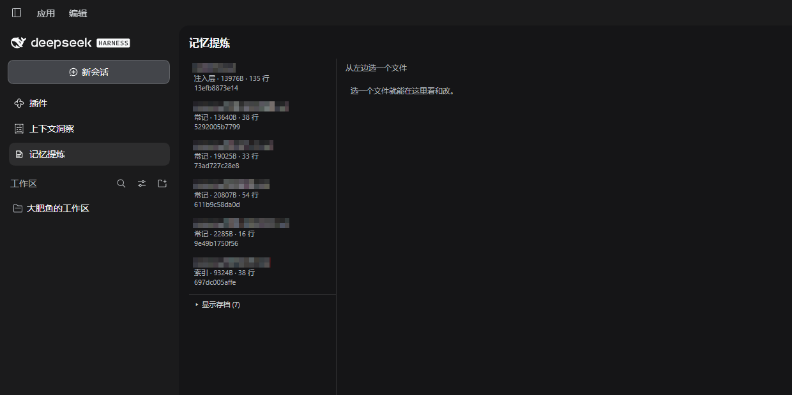
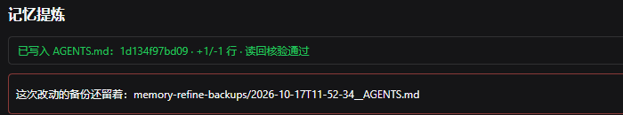

# dsh-memory-refine

**简体中文 | [English](README.en.md)**

DSH（DeepSeek Harness）的「记忆提炼」插件：把一场长对话提炼成候选条目，你逐条点头，再写进长期记忆文件 —— 面板里能直接看、直接改、直接删。

反过来也管：**它要「想起以前的事」时，不用整份读**。按关键词召回，只拿回几条带行号的片段（一条记忆一段，约 400 字），一次约 12 毫秒。

> 这不是商业产品，是我自己用出来的东西 —— 你要想要，拿去。（MIT）
> 它所有的判断都建立在一个前提上：长期记忆是你亲手确认过的东西，不是模型自己攒的。



---

## 它解决什么

- 会话日志越滚越长（一场下来几百条事件），真正的长期记忆却只有几份 `.md`；
- 手工翻记录提炼，容易漏，更容易把**引擎注入的提示词**当成「他说的话」；
- 直接改记忆文件没有安全网：写坏了没法退，两个人（人 + 模型）同时改会互相覆盖；
- 想让模型「想起以前的事」时它只有两个选择：**整份读**（一份 33KB）或者不读 —— 中间那档「只给相关的几条」原本是缺的，而「整份读」既贵又容易把别条当事实。

---

## 安装

前提：DSH 有 profile 机制（Desktop 版或带 profile 的 CLI）。

1. 把本目录放到任意位置（示例：`D:/plugins/dsh-memory-refine`）。**下面 `link:` 后面的路径要换成你自己放的位置。**

2. 在 profile 的 `package.json` 里加一条软链依赖：

   ```json
   {
     "dependencies": {
       "dsh-memory-refine": "link:D:/plugins/dsh-memory-refine"
     }
   }
   ```

3. 同一个文件的 `dsh.profile.bundles` 数组里加上它：

   ```json
   { "dsh": { "profile": { "bundles": ["dsh-memory-refine"] } } }
   ```

4. **重启整个 DSH 进程**。

> ⚠️ **改代码之后必须重启整个 DSH**。ESM 模块缓存按 URL 命中，在插件管理器里开关插件**不会**重新 import 新代码 —— 你会以为改了没生效。

装好后侧边栏会出现「记忆提炼」图标。

---

## 第一次用（面板是空的？）

新装的 DSH 通常**没有** `memory/` 目录，所以第一次打开面板时左栏可能是空的 —— 不是坏了。

不用手动建目录，两条路都能起第一份记忆：

1. **让模型建**：跟它说「帮我在 `memory/` 下建一份 `示例主题.md`，先写一行占位」。`memory_write` 会自动创建 `memory/` 目录和文件。
2. **自己建**：在 `DSH_HOME/memory/` 下新建 `.md` 文件，再点面板「刷新」。

`DSH_HOME` 在 Windows 上一般是 `C:\Users\<你的用户名>\.dsh`。

> `AGENTS.md` 是 DSH 的每轮注入层，不是插件建的。没有它插件照常工作，只是左栏少一项。

---

## 写记忆的几条规矩

插件只负责「安全地写」，**写什么**还是得靠人把握。三条踩过的坑：

1. **一条记忆一个 `<!--@refine-->` 块**。一个块里塞两件事，将来想单独改或删其中一条就扯不开了。
2. **主语写清楚**。别只写「名字，某某」—— 是给助手起名，还是说你自己叫这个？模型会宁可问你，也不乱猜（它会说：猜错了会被当成事实一直带着）。
3. **写完让它复述一遍**。「你读到的这条是什么意思，归谁？」比猜它懂没懂稳得多。

---

## 七个工具

插件注册七个模型可调用的工具，全部只碰白名单内的文件（`memory_history` 连文件都不碰，只读会话表层）。

| 工具 | 作用 |
| --- | --- |
| `memory_list` | 列出受管文件：注入层 `AGENTS.md`、索引、常记、存档，带版本哈希与行数 |
| `memory_read` | 读一份受管文件（分页），附带层级、版本、总行数 |
| `memory_recall` | 按关键词召回相关片段：返回「现成片段 + 路径:起-止行 + 版本」，不返回全文，片段够答就不必再读 |
| `memory_history` | 按关键词在**历史会话的原话**里检索，返回会话 id + 事件 seq + 时间 + 原文片段 |
| `memory_gather` | 把一场会话取成提炼素材，markdown 落盘，返回预览与统计 |
| `memory_write` | 写入受管文件。**必须用户点头**才会落盘 |
| `memory_import` | 把外部内容导入某个记忆文件（新起章节 / 追加） |

### `memory_recall`：先召回，再精读

想知道「以前聊过/定过什么」时，先用它，别整份 `memory_read`（`我们的线.md` 一份就 33KB）。**它返回的片段通常已经包含答案**——够答就直接答，不要再 read 一遍。

- **切段**：记忆文件按**条目**切（`- ` 起始行 / 空行 / 标题），一段就是一条——实测这三份文件是「一行一条记忆」（`- **标题**：正文` 全在同一个物理行），所以不需要攒字数。规则文档（注入层）保留「攒够 600 字再切」：它是一句话一条的短列表，按条目切会碎成 40 段、20 段不足 60 字。两者都有按字符硬切的兜底，不会出现 10KB 的巨段。
- **打分**：中文 2-gram 的 TF-IDF，除以段长做归一；加覆盖率门槛（query 的词命中不到一半就不返回），宁可漏也不凑。
- **存档层默认不参与**：`archive/` 是旧版快照，默认的 `scope:"live"` 会整个排除它；要翻旧版显式传 `scope:"all"`。
- **注入层也不参与**：`AGENTS.md` 每轮整份都在上下文里，召回它的段落没有信息增益，只会凭一个常见词挤进前列、占掉别处的预算；要看它显式传 `scope:"inject"`。
- **返回**：每段带 `path` / `startLine` / `endLine` / `version` 和现成片段。片段完整时 render 写的是「直接引用即可」，**不再输出 `memory_read` 命令**；只有片段被截断才给可复制的 offset 参数。召回只负责指位置，精读始终是可选项。
- **一条没命中**：返回现役文件清单（路径 + 标题）而不是空手，让模型自己挑；**不加同义词、不加模糊匹配**。
- **该并的并、该省的省**：几个互不相干的词，在**一条消息里并行**发多个 `memory_recall`；同一个词（或它的前缀）一个字都不许多查。串行每多一步，整个上下文和这一步的推理都要重付一遍——实测同一件事 4 步串行 ¥0.30、并成 1 步约 ¥0.077。看着只是「多查一次」，账单上是「多想一次」。

配套的护栏在 `memory_read`：不传 `limit` 时单次最多 **8KB**（`我们的线.md` 给到第 21 行就停），头部会写明「还有多少没给」。这道闸是必需的——实测下来，即使注入层写了「不许整份 read」，模型仍会「保守起见」调一次不带参数的 `memory_read`，而 88 行的文件在 250 行默认页下等于整份倒出 33KB。**只靠提示词管不住的事，交给代码管。**

一次召回的总预算 2400 字符（渲染后最大约 5.7KB），验收脚本：`node test/recall.mjs`（只读，跑真实数据）。

> 单段上限取 1200 字符、而不是按「每段固定给多少」是有依据的：切成一行一条之后，现役 86 段的 **P50=363、P90=740、P95=960、最长 1744**，只有 1 段超过 1200。也就是说这个值一给，**98% 的条目都是整条给完、不再挂「被截断」**。早先设 400 / 750 时一半以上的段都比窗口长，那个标记几乎每段都有——标了等于没标，还多诱发一次补读。**截断不省钱，它会诱发一次 6.5KB 的补读；一次给够更便宜。**

**用户不需要点名调用，触发规则只有一处**：注入层 `AGENTS.md`「四、记忆怎么用」里那一条——静态、每轮可见、走前缀缓存，边际成本几乎为零。

**召回刻意不注册成 skill。** skill 要先被加载才能读到正文，一次触发就多一趟工具往返 + 一份协议全文；更麻烦的是模型会为了「按规矩走」把规则再过一遍——实测出现过「先按注入层的规定想一遍，再决定要不要加载 skill，再按 skill 走一遍」的重复决策。一条规则放一个地方，它才不会自问自答。召回结果作为工具结果追加在对话末尾，同样不动系统提示词、不破前缀缓存。

> 之所以不做「每轮自动注入」：宿主确实有 `system-prompt/assemble` 钩子，但每轮往系统提示里插变量会让**从插入点往后的前缀缓存全部失效**——一场长会话（未命中输入十几万 token）那一轮的成本会翻十几倍。静态规则放注入层 `AGENTS.md`（内容不变，缓存照常命中）才是零边际成本的做法。

### `memory_gather` 的参数

| 参数 | 默认 | 说明 |
| --- | --- | --- |
| `session_id` | 当前会话 | 要提炼哪一场 |
| `mode` | `incremental` | `incremental` 只取水印之后的新轮次；`full` 取全程 |
| `boundary_seq` | 自动派生 | 手动指定边界（调试用） |
| `max_reasoning` | `0` | 每段保留多少推理字符，0 = 整段砍掉只留一行占位 |
| `out_dir` | 会话工作区下 `memory-refine-scratch/` | 素材落点 |

素材默认落在**会话自己的工作区**，不会往 DSH 的配置目录里堆。

### `memory_history`：历史会话的原话

核心记忆只存稳定结论，日常聊天不做全量提炼。可模型回答「我们之前是不是聊过 X」时，需要的是**你当时说的原话**，不是提炼过的那一版。`memory_history` 就是这条路：按关键词在历史会话里检索，返回「会话 id + 事件 seq + 时间 + 原文」。

**什么时候该用它**（只有三种情况）：

- 要的是原话或具体日期——「我当时怎么说的」「哪天定的」；
- `memory_recall` 里没有，但确信聊过。**没提炼不等于没聊过**，这两件事必须分开看；
- 核心记忆里的结论自相矛盾或明显过期，要回源头核对。

**什么时候不该用**：`memory_recall` 已经命中、片段没被标「截断」、覆盖度也够，而你要的是结论 —— 直接答完。再追一次原话是重复付费：一次冷扫是几秒和十几倍的开销（本机实测：29 场、2967 条索引、2.5 秒），换来的常常只是同一件事的另一种说法。

**命中条数不等于相关。** 这是实测踩出来的：查「不再害怕忘记」，工具返回「命中 2/2 条」——那个 2 是**返回上限**，不是相关性。其中一条覆盖率 0.40，刚刚越过 0.35 的门槛，内容是「他终于，成功了太肥鱼」，跟问题毫无关系，只是共用了几个常见词。**每一段都要看原文对不对得上再用**，别把「有结果」当成「找到了」。

它不建索引库、不建向量库、**不读磁盘上的 `session.v4.jsonl.zstd`**，只走宿主已有的 `ctx.sessionQuery`：`listSessions()` 拿会话清单 → `readSurface(id)` 拿**当前表层**的事件 → 复用 `gather.js` 的提取和 `search.js` 的中文 2-gram 分词，自己做 BM25。所以插件依旧是零外部依赖、零持久状态。

**语义边界：只查「当前表层」。** 这是最要紧的一条。

- 会话被上下文压缩（compaction）之后，被折叠掉的旧消息**不会**出现在结果里。这是**期望行为**：同一件事若有新旧两版说法，检索结果会自相矛盾，而模型会把召回当事实。
- 确实需要被折叠掉的原文，就走 `readEvent({ sessionId, seq, before, after })`（宿主 API，不在本插件内）单独展开；引用时**必须说明那是旧版**，它可能已经被新摘要取代。
- 命中条目的 `seq` 是原始事件序号，可以直接喂给 `readEvent`——这一点在 `test/history.mjs` 里有一条断言专门锁着。

其他几条口径：

- **收录面**：只收 `user/message` 与 `assistant/message` 的 `text` 块。`reasoning` 一律丢（推理不是原话），`system/message`、`developer/message`、`tool/result`、`tool/call` 全部不收。用户消息先按**事件来源**整条排除宿主注入，再对消息内嵌的 `<system-reminder>` 与 `Current runtime context.` 做文本剥离——**注入不是你说的话**。
- **两条路拦的不是同一批来源**（1.2.2 起）：

  | 来源 | 查原话（`memory_history`） | 取素材（`memory_gather`） |
  |---|---|---|
  | `time-context` 时间快照 | 丢 | 丢 |
  | `runtime-context` 运行时上下文 | 丢 | 丢 |
  | `user-approval` 批准提示 | 丢 | 丢 |
  | `repeat-tool-reminder` 工具提醒 | 丢 | 丢 |
  | `tool-jobs` 后台任务通知 | 丢 | 丢 |
  | `agent-instructions` AGENTS.md 正文 | 丢 | 丢 |
  | `skill-catalog` 技能目录 | 丢 | 丢 |
  | `goal` / `tool-goal` 目标摘要 | **丢** | **留** |
  | 没有来源标记 / 从没见过的 | 留 | 留 |

  后两类（`agent-instructions`、`skill-catalog`）的正文本来就裹在 `<system-reminder>` 里，文本剥离也能剥干净（实测 44 条 28 万字、23 条 4.5 万字，一条不剩）。仍然写进名单，是为了不依赖「它裹在哪个标签里」这个前提——按来源拦是确定的，靠文本剥是碰巧。

  `goal` 与 `tool-goal` 分开处理的原因：查原话要的是**用户亲口说的话**，目标摘要是宿主替用户写的（实测 4 条共 3,037 字、均长 759，是用户原话均长 49 字的 15 倍）；但取素材要知道**这场在忙什么**，删了就只剩两人对话、看不出上下文。
- **只点名拦，不反向删**：`source.kind` 的值是注入来源插件的名字，不是封闭枚举。所以只维护一份"要拦谁"的名单，名单外的**一律保留**，陌生的 kind 记进统计的 `unknownKinds`。代价是新注入类第一次会漏，但那点痕迹是唯一的预警；反过来的做法（不在白名单就丢）会把将来新增的正常来源悄悄删掉，还不报错。
- **门槛**：覆盖率（命中的查询词 / 查询词总数）低于 **0.35** 直接丢。会话语料比记忆文件杂，所以比 `memory_recall` 的 0.5 松；但也**不会为了「有结果」降到 0.35 以下**，一条没中就是没有。若存在覆盖率 ≥ 0.2 的候选，会在 `note` 里告诉你「最接近的只有 X」，那是让你换词，不是让你拿它顶替。
- **配额**：每场会话最多 2 条，防止一场长会话霸榜。`score` 只用于排序，**不是可信度**——工具描述里也是这么写的，别把它当「把握多大」。
- **预算**：单条原文 ≤ 200 字，单次正文总量 ≤ `max_chars`（默认 1500）。预算按「先命中的正文、再上文、最后下文」分配：正文字数按排名累加，见底就停——**总量绝不超**；被预算卡住的那一条会被截短（`truncated: true`），再往后的命中干脆不返回，`total_hits` 仍然如实报总数。

参数：

| 参数 | 默认 | 说明 |
| --- | --- | --- |
| `query` | 必填 | 关键词或短语，中文直接写，用实体词而不是整句 |
| `session_id` | 全部会话 | 只在这一场里搜 |
| `limit` | `5` | 最多返回几条，上限 10 |
| `context` | `0` | 每条命中额外带前后各几条（同会话、按 seq 相邻），上限 4 |
| `max_chars` | `1500` | 正文总字数上限，上限 4000；只算原文，不含标题与统计 |
| `scan_limit` | `50` | 最多扫多少场（从最新往旧） |
| `refresh` | 省略 | 手动重建索引：填会话 id 只重建这一场，填 `"all"` 清空全部缓存 |

**`refresh` 与 `scan_limit` 的关系**（容易想歪，这里定死）：`refresh` 只作用于**缓存**，不扩大扫描范围。`scan_limit` 永远是本次读会话的上限，`refresh: "all"` 也突破不了它。所以 `refresh: "all"` 的语义是「清空全部缓存 + 重建本次扫到的那几场」，没扫到的会话只是「暂时没有缓存」，下次查询时再建。统计里 `refreshed` 记的是「清掉了什么」（`['all']` 或某个 id），**不是**「重建了几场」——那要看 `sessions_scanned`，返回里的 `note` 也会写确切的重建数；`refresh` 之后 `sessions_from_cache` 必为 0（缓存已空，没有可命中的）。

**缓存**：缓存的是提取后的记录 + 倒排，不是原始事件——省掉的正是 `readSurface` 背后那一次全量读盘 + 回放校验。

- 会话还在跑（`live: true`）：每次查询都重读并核对 `capturedThroughSeq`，变了才重建索引。所以**活跃会话里新说的话立刻能查到**。
- 会话已经不在跑（`live: false`）：首次建索引后直接复用，不再读盘。这是基于「切换会话即断舍离」的使用约定做的优化，**不是系统保证**——宿主允许旧会话被重新启用并继续追加事件。真遇到了就 `refresh: "<那个 id>"` 手动重建；重启 DSH 后缓存本来就是空的。
- 上限 32 场，按最久未重建淘汰。

**为什么不用 DSH 自带的全文检索**：本部署的 `session-query-sqlite` 是 `openAt: never`（刻意关掉的），调用只会拿到 `SESSION_QUERY_SEARCH_DISABLED`；而且它的 tokenizer 是 `unicode61`，按 token 匹配而不是任意子串（`AI` 匹配不到 `BRAID`），中文召回很差。开不开都不该依赖它。

单元测试：`node --test test/history.mjs`（35 条，注入假 `sessionQuery`，不碰真实数据）；注入过滤单独一份 `test/injection.mjs`（10 条，T24–T33），两份都不碰真实记忆文件。

---

## 面板

左侧「记忆提炼」图标 → 主面板。

- **左栏**：受管文件列表。存档默认折叠（`显示存档 (N)`），点一次展开。
- **右栏**：选中文件的正文，可以直接改。改完按「保存」。
- **顶栏**：
  - `刷新`：作废缓存，重新读磁盘。
  - `清理素材…`：删掉本会话工作区下 `memory-refine-scratch/` 里的素材文件（`material-*.md` / `tools-*.md`）。会先问一次，只认这两个前缀，不递归子目录。
- **写入后**：上方会留一条 `这版没问题，删掉备份` —— 你按下它，这次改动留下的那份备份才会被删掉。不按就留着。
- **重新读取**：选中一个文件，按「重新读取」→ 从磁盘再读一次。**保存时如果报「在你看过之后被改动过」，就用它** —— 多半是模型或另一个窗口刚写过这个文件。有没保存的改动时会先问你一句。
- **删除文件**：选中一个文件，按「删除…」→ 确认。会先整份备份到 `memory-refine-backups/` 再删。
- **导入…**：填目标文件 + 章节标题，然后在下面那个大框里放内容。大框两种填法都认：
  - **贴正文** —— 直接把要导入的文字粘进去；
  - **填绝对路径** —— 只写一个文件的完整路径（如 `D:\旧笔记.md`），它会自己去读那个文件。省得把几万字粘进来。
    判定收得很紧：**单行、长度 ≤ 4096、且是绝对路径、且文件确实存在**，四条全中才当路径；否则一律当正文。所以正文里恰好写了路径不会被误读。相对路径**不认**（Host 里没有确定的基准目录，猜错了会读到别的文件）。

> 注入层 `AGENTS.md` 在面板里**不可删除**，只能改。

---

## 安全设计

写入永远走同一条路（`index.js` 里的 `confirmAndWrite`）：

1. **版本哈希预检** —— 你手上这份的版本和磁盘上的对不上，直接中止，一个字节都不写；
2. **整份备份** —— 先落一份到 `DSH_HOME/memory-refine-backups/`；
3. **写后读回核验** —— 写完立刻读回来逐字比对，不一致就报失败。

一次成功的写入长这样（版本、行数变化、核验结果、备份路径都在一条里）：



另外：

- **写入必须用户点头**。拿不到问答服务时直接拒绝，**不静默降级**成「自动同意」。
- **白名单**：只认 `DSH_HOME/AGENTS.md` 与 `DSH_HOME/memory/**/*.md`。`..` 越界、盘外路径一律拒绝。
- **斜杠命令载荷不记录**：命令注册时 `recordInput: false`，会话日志里不会重复存一份完整输入 JSON。命令通道现在只是兜底，正常不走它（见下一节）。

---

## 面板怎么跟后台通信

面板跑在浏览器里，Host 跑在另一个进程 —— 中间没有私有的插件 RPC 通道（DSH 的能力集合在构建时固定，第三方插件加不进去）。

所以插件在 Host 半边挂了一条自己的 HTTP 路由：

```
POST /memory-refine/ui          ← 面板的每一次操作都走这里
  请求 { action, sessionId, ... }
  响应 { ok: true, data } 或 { ok: false, error }
```

这条路由：

- 只接受**本机、且通过 `connection.requestRejection` 信任校验**的请求（不自己造 token）；
- 四道闸：只认 `POST`；只认 `content-type: application/json`；请求体 8 MB 上限；鉴权不过直接 401/403；
- 把 `sessionId` 翻译成 agent 后交给**同一套** `handleUiRequest` —— 白名单、版本预检、备份、读回核验，和工具那条路走的是同一份代码。

**为什么需要它**：斜杠命令（`ctx.remote.commands.execute`）是第三方插件唯一能调到 Host 的方式，但它**按设计会往会话日志里写一对 `command/run` / `command/done`**，在对话视图里显示成一条 `memory-refine · {...}` 记录。走 HTTP 路由不进命令总线，就没有这条记录。

**兜底**：要是路由没注册上（老版本 DSH 没有 `webServer`），或者请求被拦，面板会自动回退到斜杠命令，并在顶部挂一条红色警告 —— 不会悄悄留痕。

---

## 会话取料是怎么做的

直接读 DSH 的会话事件流（`sessionQuery.readSession`），不碰磁盘上的 `session.v4.jsonl.zstd` —— 不用自己解多帧 zstd。

丢弃的东西：

- **按来源整条排除的宿主事件**：`time-context`、`runtime-context`、`user-approval`、`repeat-tool-reminder`、`tool-jobs`、`agent-instructions`、`skill-catalog`。它们每轮都以 `user/message` 的身份写进来，长得和用户发言一模一样，换过措辞的新形态靠文本剥不掉。`goal` / `tool-goal` 在这条路上**有意保留**（素材要知道这场在忙什么），查原话那条路会拦——见上文对照表；
- `<system-reminder>` 整块（AGENTS.md 变更通知就是这么进来的，**最容易被当成「他说的」**）；
- 裸运行时快照（`Current runtime context.` 之后的全部）；
- `request/header` 里的提示词清单；
- 推理正文（只留一行 `<!-- 推理已省略：本段 N 处共 X 字 -->`）。

### 水印：零外部状态

每次取料会在素材首行写：

```
<!--memory-refine:watermark session=<id> seq=<n> time=<t> turns=<k>-->
```

下次取料时，`deriveWatermark()` 扫一遍会话日志里的 `tool/result`，找上一次 `memory_gather` 留下的那行，取出 `seq` 当边界。

**好处**：不需要任何外部状态文件，不会像 `handledIds` 那样无限膨胀，天然按会话隔离。边界落在**轮**上（`user.seq > boundarySeq`），所以不会切在某一轮中间。

---

## 目录结构

```
memory-refine/
├── index.js         Host 半边：skill + 7 个工具 + 界面命令桥
├── client.js        浏览器半边：侧边栏图标 + 主面板
├── gather.js        纯函数：会话事件流 → 提炼素材（无 cordis 依赖，可单独测）
├── memory.js        受管文件访问层：白名单 + 版本哈希 + 备份 + 读回核验
├── protocol.js      提炼协议全文（作为 skill 注入）
├── search.js        纯函数：切段 + 分词 + TF-IDF 打分（召回用，可单独测）
├── history.js       历史会话原话检索：缓存 + 倒排 + BM25（memory_history 用，可单独测）
├── test/recall.mjs  召回验收：跑真实记忆数据，只读
├── test/history.mjs 历史检索单元测试：假 sessionQuery，不碰真实会话
├── test/smoke.mjs   离线冒烟测试：假 ctx + 沙盒 DSH_HOME
├── cordis.patch.yml 告诉 DSH 装哪一行
└── package.json
```

`gather.js` 刻意做成纯函数：输入事件数组，输出文本，不碰磁盘。这样可以拿导出的会话日志在沙盒里反复重放，不用重启 DSH。

---

## 测试

```
node --test "test/*.mjs"
```

三个文件，都不需要启动 DSH：

| 文件 | 验什么 | 需不需要真数据 |
| --- | --- | --- |
| `test/smoke.mjs` | 四道闸、白名单、版本预检、读回核验、备份 | 否（沙盒 `DSH_HOME`） |
| `test/history.mjs` | `memory_history` 的收录面、门槛、配额、预算、缓存与 `refresh` | 否（假 `sessionQuery`） |
| `test/recall.mjs` | 召回质量与非功能约束 | **是**（读真实记忆文件，只读；`~/.dsh` 下没有 `memory/` 就跳过） |

> `test/recall.mjs` 的断言绑的是真实记忆文件的形状，所以**记忆文件本身一改，它就可能变红**——那不是插件坏了，是数据漂移。遇到先看它报的是哪一条、对应哪一行，别去调门槛。
>
> 1.2.2 起行号不再写死：改成读文件现算关键词落在第几行（`linesContaining()`）。以前写死 `79 / 86 / 68`，文件加两行就三条一起红；现在文件怎么增删都跟着走，只有关键词真从文件里消失才会报。剩下的脆弱点只有「一行一条记忆」那一条，它验的是条目之间有没有空行 —— 那确实是文件内容问题。

冒烟测试 20 条断言，重点不在「功能能跑」，而在**手动点不出来的那些分支**：

- 四道闸：只认 `POST`（405）、只认已知子路径（404）、只认 JSON（415）、鉴权拒绝原样透传（403）
- 白名单越界被拒（`../../etc/passwd`）
- 写入：读回核验通过、备份文件真的生成了
- **版本不符时中止**（`deadbeefdeadbeef` → 一个字节不写）
- 导入的章节间距、删除的备份命名与「确实没了」的核验

这些分支在真实环境里要一条条制造出来，每条都得重启一次 DSH；在断言里是三行。

`test/history.mjs` 里 T3–T18 覆盖的是缓存与预算这类「不注入假数据就验不了」的行为，其中两条是最容易做错的：

- **T16b**：`refresh: "all"` 配 `scan_limit: 1` —— 锁住「刷新只清缓存、不扩大扫描范围」这个口径，`sessions_scanned` 必须是 1 而不是全部。
- **T18**：活跃会话追加消息后，新说的话必须立刻能检索到（说明索引真的重建了，而不是只重读了一遍事件却还在用旧索引）。

**真实回归 T1/T2 必须手工跑**（在真会话里查「内核」「workbuddy」），因为假数据证明不了「候选确实来自真实表层、seq 确实能对回原文」。步骤见上面的 `memory_history` 一节。

---

## 卸载

1. 从 profile 的 `package.json` 里去掉 `dsh-memory-refine` 依赖；
2. 从 `dsh.profile.bundles` 数组里去掉 `"dsh-memory-refine"`；
3. **重启 DSH**；
4. 可选清理：
   - `DSH_HOME/memory-refine-backups/` —— 写入前的备份（留着也许有用）；
   - 会话工作区下的 `memory-refine-scratch/` —— 取出来的素材（可以直接删）。

卸载**不会**动 `AGENTS.md` 和 `memory/` 里的任何东西。

---

## 已知限制

- **命令通道是兜底，不是主路。** 面板默认走插件自己的本地 HTTP 路由（`POST /memory-refine/ui`），**不经过命令总线**，所以正常使用时对话视图里不会出现 `memory-refine · {...}` 记录。只有在路由不可用时才回退到 `/memory-refine` 斜杠命令，留下一对 `command/run` / `command/done` —— 这时面板顶部会挂一条红色警告，告诉你发生了降级。这组事件**不进模型历史、不烧 token、不污染取料素材**。
- 面板在「一个会话都没打开过」时无法确定会话 id，会提示先打开一个会话。
- **`memory_history` 的耗时只有一次实测，不是基准。** 本机冷扫 29 场 / 2967 条索引 / 2557ms（2026-10-27，一次观测）。分词 + 倒排 + 打分在 62 万字规模是 0.1 秒量级（CPU 侧微基准），瓶颈在 `readSurface` 背后的全量读盘 + 回放校验，而那条路径在插件进程外没有入口、测不了。所以工具描述里不承诺任何耗时，返回里的 `elapsed_ms` 才是每次自己的实测值；同一份 README 也不写「1 秒内」这种话。
- **`memory_history` 看不到被压缩掉的历史。** 这是设计如此，不是缺陷：它只读当前表层。要旧原文得走宿主的 `readEvent`。也因此它说「没搜到」比记忆文件说「没记过」更弱 —— 别把它的沉默当成「没聊过」。
- **注入事件在两条路上都会被检查，但计数没去重。** `user/message` 与 `agent/inbox/spliced` 的 `inserted[]` 各查一次。2026-10-27 实测 497/497 条 `inserted` 都带 source、且没有注入 kind，所以统计是对的；**若宿主将来把注入事件放进 `inserted`，会出现重复计数**。
- **`goal` / `tool-goal` 进不进，取决于用途。** 取素材时保留（要知道这场在忙什么），查原话时排除（那是宿主替用户写的，不是用户的话）。所以对同一段会话，两个工具看到的"用户消息"条数本来就可以不同，这不是计数错。整条保留意味着素材里会出现宿主口吻的段落，是已知代价。
- **陌生来源只留痕，不拦。** 名单外的 `kind` 一律放行，名字记进统计的 `unknownKinds`。宿主将来新增注入类时，第一次会漏进来——那行统计是唯一的预警，看到陌生名字就把它加进名单。
- 只在 **Windows** 上验证过。
